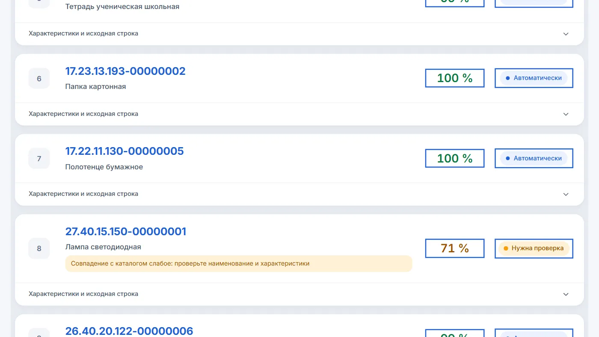

# ЕИС Классификатор

Проект команды **BigToBoss** для кейса № 5 хакатона B2B-РТС.
Приложение подбирает коды КТРУ по закупочной спецификации, показывает уверенность
и помогает специалисту проверить спорные позиции. Результат выгружается в Excel или CSV.

- [Видео с демонстрацией приложения](Video/BigToBoss.mp4), 4 минуты 27 секунд.
- [Датасет: файлы для загрузки и эталонные ответы](dataset/README.md).
- [Каталог КТРУ и готовые векторы](https://github.com/loresab-cup/ktru-lite/releases/tag/catalog_yandex).

## Запуск

Нужны Docker с Docker Compose и интернет для загрузки образов и каталога.

    git clone https://github.com/loresab-cup/ktru-lite.git
    cd ktru-lite
    cp .env.example .env

В созданном .env заполните YANDEX_API_KEY и YANDEX_FOLDER_ID своими данными
Yandex AI Studio. Они используются для YandexGPT и эмбеддингов. При необходимости
для эмбеддингов можно отдельно указать YANDEX_EMBED_API_KEY и YANDEX_EMBED_FOLDER_ID.
Дополнительные ключи YANDEX2_API_KEY–YANDEX5_API_KEY необязательны.

    docker compose up --build

Откройте **http://localhost:3000**. При первом запуске сервис catalog загружает
два файла каталога в db/ из релиза GitHub, если их ещё нет локально.
Загрузка каталога и сборка образов требуют времени. Если автоматическая загрузка
не удалась, скачайте файлы вручную по [инструкции](db/README.md).

Состояние сервера: http://localhost:8000/api/health.
Каталог готов к работе, когда поле catalog имеет значение ready.
Документация API: http://localhost:8000/api/docs.

## Вход для организаторов

**Логин: admin. Пароль: admin.**

При стандартном запуске аккаунт и сохранённый пример на 1000 позиций создаются
автоматически. Можно сразу открыть пример, посмотреть результаты, исправить код
и выгрузить таблицу, без регистрации и нового обращения к нейросети.
Это сохранённый демонстрационный прогон, а не новый замер.

При входе примите политику конфиденциальности и согласие на обработку файлов.
Существующий аккаунт с другим паролем не перезаписывается. Для размещения без
стартовой учётной записи и примера предусмотрено JURY_DATA=0.

## Пользовательский сценарий

1. Загрузить XLSX, CSV, DOCX, PDF или TXT либо выбрать встроенный пример.
2. Следить за обработкой: готовые строки появляются до завершения всего задания.
3. Посмотреть код КТРУ, характеристики, уверенность и статус каждой позиции.
4. Проверить спорные строки: сравнить кандидатов, выбрать или ввести код,
   уточнить атрибуты. Решения человека сохраняются для повторяющихся строк.
5. Выгрузить результат в Excel или CSV.

Каталог доступен и для самостоятельного поиска. По ссылке кода можно открыть
официальную карточку ЕИС. Для работы без учётной записи предусмотрен гостевой режим.

## Техническое решение

React 19 и Ant Design отвечают за интерфейс. FastAPI принимает файлы и возвращает
результаты. Celery и Redis выполняют обработку в отдельном worker-процессе.
PostgreSQL хранит задания, позиции и решения пользователя; pgvector выполняет
точный векторный поиск по 81 509 позициям каталога.

YandexGPT извлекает наименование, бренд, модель и характеристики. Значения
проверяются по исходной строке. Эмбеддинги Yandex AI Studio используются для поиска
по смыслу; правила дополнительно сравнивают характеристики, единицы и диапазоны.
Уверенность учитывает оценку лучшего кандидата и его отрыв от альтернатив.
У ручного решения процент модели не показывается.

| Папка | Содержимое |
| --- | --- |
| backend/ | API, разбор файлов, очередь, поиск, выгрузка и миграции базы |
| frontend/ | Интерфейс, встроенный пример и обучение |
| dataset/ | Исходные спецификации, изменённые варианты и эталонные ответы |
| db/ | Инструкция получения каталога; большие файлы находятся в релизе |
| Video/ | Финальный ролик для организаторов |

## Ограничения

- PDF читается по текстовому слою. Распознавание сканов пока не подключено.
- Уверенность — оценка алгоритма, поэтому спорные результаты проверяет специалист.
- Новая обработка использует API Yandex AI Studio и расходует квоту ваших ключей.
  Скорость зависит от доступности API и лимитов облака.
- Если внешние модели недоступны, приложение использует резервный разбор правилами
  и сообщает об ограниченном режиме в интерфейсе.
- Файлы ограничены 10 МБ и 5000 позициями. Данные разных пользователей изолированы.

Ключи, локальная база, исходники записи и рабочие отчёты не входят в репозиторий.
