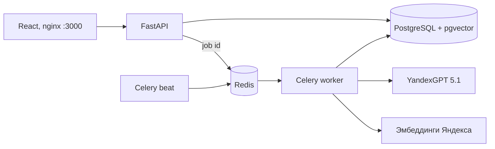

# ЕИС Классификатор — кейс № 5 B2B-РТС

Сервис подбирает коды КТРУ для спецификаций закупок. Пользователь загружает XLSX, CSV, PDF
(а также DOCX и TXT). Система достаёт из каждой строки наименование, бренд, модель и
характеристики, подбирает код из каталога (81 509 кодов) и показывает процент уверенности.
Спорные позиции человек проверяет и исправляет в интерфейсе, результат выгружается в XLSX или CSV.

**Стек:** React SPA, FastAPI (REST), Celery + Redis (очередь), PostgreSQL + pgvector (данные и
векторный поиск), Yandex AI Studio (YandexGPT 5.1 для атрибутов, эмбеддинги text-search для поиска).
Всё собирается в Docker и запускается одной командой.

## Соответствие критериям кейса

Замеры 29 октября 2026 на этом стеке, через работающий сайт. Отчёты лежат в `eval/reports/`.

| № | Критерий ТЗ | Требование | Результат |
| --- | --- | --- | --- |
| 1 | Извлечение атрибутов | ≥ 90 % (наименование, бренд, модель) | набор из 100 разнообразных строк: наименование 99/100, бренд 100/100, модель 99/100; 12 строк приёмки — 12/12 по каждому полю |
| 2 | Точность классификации | ≥ 85 % на тестовом наборе | 1000 строк организаторов: точный код 989–990 из 1000; 292 строки: 292/292; остальные наборы — в разделе «Проверка» |
| 3 | Массовая обработка | 1000 позиций < 5 минут | 201 с с одним ключом на чистой установке; 103 с с пятью ключами из четырёх облаков |
| 4 | Вывод уверенности | % для каждого товара | процент у каждой из 1000 автоматических позиций, у спорных — причина словами |
| 5 | Ручная корректировка | исправить код в интерфейсе | выбор из пяти кандидатов, поиск по каталогу, ввод кода, правка атрибутов; приёмка ставит другой код и находит его в обеих выгрузках |
| 6 | Асинхронность | очередь задач | Celery + Redis: API отвечает 202 за 0,01–0,1 с, файл обрабатывает отдельный worker |
| 7 | Архитектура | `docker-compose up --build` | одна команда; файлы каталога скачиваются сами (см. «Запуск») |

Требования к развёртыванию: PDF на 78 страниц (таблица Word, 292 позиции) — ответ 202 за 0,09 с,
обработка 49 с, 292 из 292 кодов верны, ошибки 504 нет. Интерфейс с обучением на 8 шагов,
адаптивный (телефон, планшет, компьютер). Работать можно без входа: после согласия с политикой
конфиденциальности файлы и результаты хранятся, пока открыт браузер. Вход и регистрация сохраняют
их в учётной записи.

## Запуск

Нужны Docker Desktop (Windows, macOS) или Docker Engine с Compose v2, около 6 ГБ диска,
4 ГБ свободной памяти и интернет.

1. Склонируйте репозиторий и перейдите в папку проекта.
2. Скопируйте настройки и впишите ключи Yandex AI Studio:

   ```bash
   cp .env.example .env
   ```

   В `.env` достаточно двух строк: `YANDEX_API_KEY` и `YANDEX_FOLDER_ID` — API-ключ Yandex AI
   Studio и ID каталога в Yandex Cloud (`b1g…`). Этот ключ работает и для YandexGPT, и для
   эмбеддингов. Отдельный ключ эмбеддингов (`YANDEX_EMBED_*`) и ключи `YANDEX2_API_KEY` …
   `YANDEX5_API_KEY` необязательны: дополнительные ключи из других облаков ускоряют обработку.
3. Запустите:

   ```bash
   docker compose up --build
   ```

4. Откройте http://localhost:3000. Чтобы сразу начать, отметьте согласие с политикой и нажмите
   «Продолжить без входа». Чтобы файлы хранились и после закрытия браузера, выберите «Регистрация».

При первом запуске сервис `catalog` скачивает в `db/` два файла каталога из релиза
[catalog_yandex](https://github.com/loresab-cup/ktru-lite/releases/tag/catalog_yandex) и
проверяет их контрольные суммы. Если скачать не получилось (нет интернета или нет доступа к
репозиторию), скачайте их вручную и положите в `db/`:

| Файл | Размер | SHA-256 |
| --- | ---: | --- |
| `ktru_catalog.jsonl.gz` | 344 098 850 байт | `eba3fc1009ce002f0bd38f516e0c50b53bb5f20b1b6af97edb3ce87a5081b8d1` |
| `ktru_vectors_yandex.npz` | 90 312 482 байта | `4cdfb43563edda2d2b323564c96beedf59bec8f797779c54760cc922d3f1707d` |

Первый запуск собирает образы (5–10 минут) и загружает векторы каталога в PostgreSQL. Сайт
готов, когда `http://localhost:8000/api/health` отвечает `"catalog": "ready"`. Без ключей
нейросетей сайт работает, но атрибуты разбираются правилами, а коды ищутся только по словам —
об этом говорят плашки на главной. Проверить ключи:

```bash
docker compose exec backend python check_llm.py
```

Остановить — `docker compose stop`, журналы — `docker compose logs -f backend worker`.
Команда `docker compose down -v` удаляет все данные, включая пользователей.

## Как это работает



1. API сохраняет файл и задание в PostgreSQL, кладёт номер задания в Redis и сразу отвечает 202.
2. Worker разбирает файл на позиции (`parser.py`): листы XLSX, CSV в UTF-8 или CP1251, таблицы
   PDF и DOCX. Строка таблицы PDF, разорванная концом страницы, склеивается обратно.
3. YandexGPT пачками по 10 строк достаёт наименование, бренд, модель и характеристики
   (`extractor.py`). Значение остаётся, только если оно дословно есть в исходной строке:
   нейросеть не может ничего придумать. Строки передаются ей как данные, а не как инструкции.
4. Текст строки превращается в вектор моделью `text-search-query`. pgvector находит ближайшие
   коды каталога (векторы каталога заранее построены моделью `text-search-doc`), BM25 добавляет
   коды с теми же словами в названии.
5. Правила ранжирования сверяют характеристики, единицы и числовые диапазоны; наименование из
   начала строки удерживает товар («Цифровой микроскоп» не уходит в «Микроскоп световой»).
6. Уверенность — логистическая функция от оценки лучшего кода и отрыва от второго
   (`confidence.py`). От 85 % код ставится автоматически, ниже — позиция ждёт проверки, и сайт
   пишет почему. Для спорных строк YandexGPT даёт второе мнение, выбирая только из пяти
   найденных кодов.
7. Готовые строки появляются на странице по мере обработки. Человек принимает или меняет код,
   выгружает XLSX или CSV. Ручные решения запоминаются и подставляются в его следующие файлы.

Пять ключей YandexGPT работают одновременно. При `YANDEX_PARALLEL=auto` ключи одного каталога
делят 5 одновременных генераций облака, ключи других облаков добавляют ещё по 5. Ключ, который
отвечает ошибкой, ставится на паузу, его пачки берут остальные. Если нейросеть недоступна целиком,
атрибуты разбираются правилами, и задание всё равно заканчивается.

Каждый пользователь видит только свои спецификации. Пароли хранятся как scrypt, сессия — в
cookie HttpOnly. Перед первой загрузкой пользователь соглашается на обработку файлов (политика —
на странице `/privacy`).

## Примеры API

Документация со схемами: http://localhost:8000/api/docs. Ниже — полный сценарий через curl:
регистрация, согласие, загрузка, ожидание, правка кода, выгрузка. Cookie сессии хранится в файле.

```bash
API=http://localhost:3000
VERSION=$(curl -s $API/api/legal | python -c "import json,sys; print(json.load(sys.stdin)['version'])")

# Регистрация (сразу входит) и согласие на обработку файлов
curl -s -c cookies.txt -H "Content-Type: application/json" \
  -d "{\"login\":\"demo-user\",\"password\":\"demo-password-1\",\"privacy_version\":\"$VERSION\",\"privacy_accepted\":true}" \
  $API/api/auth/register
curl -s -b cookies.txt -H "Content-Type: application/json" \
  -d "{\"purpose\":\"files\",\"accepted\":true,\"version\":\"$VERSION\"}" $API/api/auth/consents

# Загрузка: ответ 202 и номер задания
JOB=$(curl -s -b cookies.txt -F "file=@frontend/public/primer.xlsx" $API/api/jobs \
  | python -c "import json,sys; print(json.load(sys.stdin)['job_id'])")

# Ожидание: status queued -> processing -> done, processed растёт по мере обработки
curl -s -b cookies.txt $API/api/jobs/$JOB

# Позиции: код, наименование кода, уверенность, статус, атрибуты, пять кандидатов
curl -s -b cookies.txt "$API/api/jobs/$JOB/items?limit=20"

# Ручная правка кода позиции (id из списка позиций)
curl -s -b cookies.txt -X PATCH -H "Content-Type: application/json" \
  -d '{"ktru_code":"26.20.11.110-00000165"}' $API/api/items/<id>

# Выгрузка
curl -s -b cookies.txt -o result.xlsx "$API/api/jobs/$JOB/export?format=xlsx"
```

Вход в существующую учётную запись: `POST /api/auth/login` с `{"login": "...", "password": "..."}`.
Без учётной записи: `POST /api/auth/guest` с `{"privacy_version": "$VERSION", "privacy_accepted": true}`;
cookie гостя без срока действия, сервер удаляет гостя и его файлы через `GUEST_HOURS` (12) часов
или после выхода, а вход или регистрация из такой сессии переносят его спецификации в учётную запись.
Ещё адреса: `POST /api/items/{id}/accept` (принять код), `POST /api/items/{id}/undo-code`,
`POST /api/jobs/{id}/accept?min_confidence=85` (принять все от порога), `POST /api/jobs/{id}/cancel`,
`GET /api/catalog/search?q=бумага` (поиск по каталогу), `GET /api/health` (состояние сервиса).
Ошибки приходят как `{"detail": "текст по-русски"}`.

## Проверка

```bash
python scripts/acceptance.py --live
```

Приёмка через API работающего стека, отчёт пишется в `outputs/acceptance/report.json`. Она
проверяет PDF на 51 странице, атрибуты 12 строк, 1000 строк организаторов (точность ≥ 850,
время < 300 с), процент у каждой позиции, ручную замену на другой код, содержимое CSV и XLSX и то,
что второй аккаунт не видит чужое задание. Флаг `--live` тратит запросы к YandexGPT.

Замеры всех размеченных наборов 29.10.2026 (`scripts/bench.py` через сайт):

| Набор | Строк | Точный код | В авто | Неверных в авто | Время |
| --- | ---: | ---: | ---: | ---: | ---: |
| реальная спецификация | 12 | 12 | 8 | 0 | 8 с |
| форма ЕИС | 3 | 3 | 3 | 0 | 3 с |
| форма ЕИС, изменённая | 3 | 3 | 3 | 0 | 3 с |
| пример сайта | 11 | 11 | 9 | 0 | 9 с |
| 292 строки организаторов | 292 | 292 | 268 | 0 | 33 с |
| 292 строки, изменённые | 292 | 289 | 260 | 0 | 46 с |
| 1000 строк организаторов | 1000 | 989 | — | — | 103 с |
| 1000 строк, изменённые | 1000 | 986 | 803 | 2 | 91 с |
| human_1000 (770 строк с кодом) | 770 | 759 | 667 | 2 | 99 с |

Для 1000 строк организаторов цифры приёмки: она не считает зону авто. В human_1000 ещё 200 неполных
описаний (в авто 66) и 30 служебных строк (в авто 0). Строк, разобранных правилами вместо
нейросети, во всех наборах 0.

Атрибуты на отдельном наборе из 100 строк (`dataset/attributes_2026_10_29`, разметка составлена до
первого прогона; 75 строк для разработки, 25 отложены):

| Часть | Наименование | Бренд | Модель |
| --- | ---: | ---: | ---: |
| разработка, 75 | 75 | 75 | 75 |
| отложенная, 25 | 24 | 25 | 24 |

Тесты без сети: `cd backend && python -m pytest -q tests` (253 теста) и
`cd frontend && npm test`; линтеры — `ruff` и `npm run lint`.

## Ограничения

- PDF читается по текстовому слою: сканы без текста (OCR) не поддерживаются.
- Скорость зависит от ключей: с одним ключом одного облака 1000 строк идут дольше
  (ограничение облака — 5 одновременных генераций), предел ТЗ в 300 с при этом соблюдается
  (197 с с одним запросом на ключ). Эмбеддинги облака — около 10 запросов в секунду.
- Процент уверенности — оценка алгоритма по сходству и отрыву от второго кода, а не вероятность.
  У кода, выбранного человеком, процента нет: это решение человека.

## Документация

- [Архитектура по кейсу и проверки](docs/case5-architecture.md)
- [Карта исходников](docs/project-structure.md), [устройство backend](docs/backend-structure.md)
- [Каталог и векторы](docs/catalog-preparation.md), [миграции и резервные копии](docs/database-migrations.md)
- [Персональные данные и доступ](docs/privacy-and-ownership.md)
- [Отчёт о сдаче 29.10.2026](docs/submission-report-2026-10-29.md)
- [Прежний подробный README](docs/archive/README-before-case5-stack.md) — история решений
