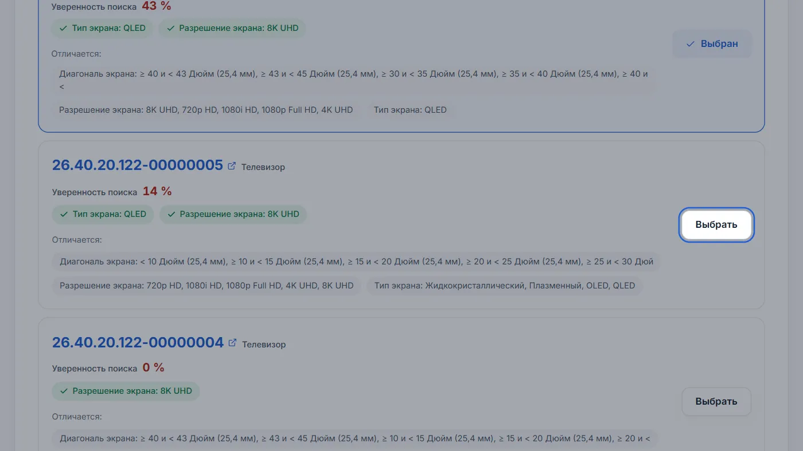
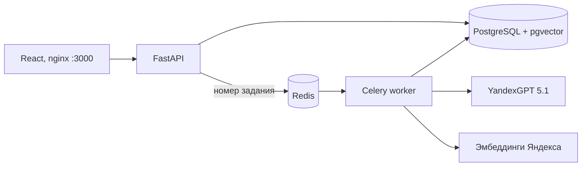

# ЕИС Классификатор

Сервис для кейса № 5 хакатона B2B-РТС. Он подбирает коды КТРУ для товарных спецификаций
госзакупок: вы загружаете файл, система разбирает каждую строку, находит код в каталоге КТРУ
(81 509 позиций) и показывает, насколько она в нём уверена. Спорные строки человек проверяет и
исправляет в интерфейсе, готовый результат выгружается в Excel или CSV.


## Результаты по критериям кейса

Замеры 29 октября 2026 года через работающий сайт. Отчёты лежат в `eval/reports/`.

| Критерий | Требование | Результат |
| --- | --- | --- |
| Извлечение атрибутов | ≥ 90 % | 100 разных строк: наименование 99, бренд 100, модель 99 |
| Точность классификации | ≥ 85 % | наш внутренний набор: 991 верный код из 1000 (99,1%); независимая проверка новых данных ещё нужна |
| Массовая обработка | 1000 позиций быстрее 5 минут | тот же сохранённый прогон: 121 с, пять ключей, одно задание |
| Уверенность | процент у каждого товара | у каждой позиции; у спорных ещё и причина словами |
| Ручная корректировка | исправить код в интерфейсе | выбор из кандидатов, поиск по каталогу, ввод кода, правка атрибутов |
| Асинхронность | очередь задач | Celery + Redis: загрузка отвечает за 0,01–0,1 с, файл обрабатывает отдельный процесс |
| Развёртывание | `docker-compose up --build` | одна команда из комплекта с каталогом в `db/` |

PDF на 78 страниц (292 позиции) принимается за 0,09 с и обрабатывается за 49 с без ошибки 504.

## Запуск

Нужны Docker Desktop (или Docker Engine с Compose v2), около 6 ГБ диска, 4 ГБ памяти и интернет.

```bash
git clone https://github.com/loresab-cup/ktru-lite.git
cd ktru-lite
cp .env.example .env
```

В `.env` впишите две строки: `YANDEX_API_KEY` — API-ключ Yandex AI Studio и `YANDEX_FOLDER_ID` —
ID каталога в Yandex Cloud (начинается с `b1g`). Остальные ключи необязательны: дополнительные
ключи из других облаков ускоряют обработку.

```bash
docker compose up --build
```

Откройте http://localhost:3000. Первый запуск занимает 5–10 минут: собираются образы и
проверяются два файла каталога (434 МБ). Сайт готов, когда
http://localhost:8000/api/health отвечает `"catalog": "ready"`.

### Вход для жюри

После обычного `docker compose up --build` аккаунт и пример создаются автоматически.
Войдите на сайте: **логин `admin`, пароль `admin`**. В «Недавних» будет спецификация
`Спецификация_1000_строк.xlsx` с 1000 результатами: 991 код совпал с нашим эталоном.
Это сохранённый внутренний прогон от 29 октября, восстановленный до ручной корректировки;
его импорт не вызывает нейросеть и не является новым замером. Спорные строки и девять
несовпадений сохранены. Подробности: [проверка демо](docs/demo.md).

Никаких дополнительных команд или платного прогона для появления примера не нужно.
Существующий аккаунт с другим паролем не перезаписывается. Для размещения без стартовых
данных задайте `JURY_DATA=0`; пароль существующего аккаунта измените в профиле.
Обычная регистрация требует минимум 8 знаков. Другие новые аккаунты не получают этот пример.

**Для жюри:** используйте комплект передачи с двумя файлами `db/` внутри. Его собирает
`python scripts/package_delivery.py outputs/delivery.zip` из рабочей копии с каталогом;
локальные ключи и `.env` в архив не попадают. После распаковки заполните `.env` по примеру
и выполните ту же команду Docker Compose.

В чистом clone файлов каталога нет. Релиз приватного репозитория без доступа отвечает 404;
автоскачивание возможно только при доступном адресе `CATALOG_RELEASE_URL` в `.env`.
Положите файлы в папку `db/` вручную — ссылки и суммы есть в
[подробном описании](README_FULL.md#запуск). Проверить ключи Яндекса:
`docker compose exec backend python check_llm.py`.

## Что умеет сайт

- **Принимает** XLSX, CSV, PDF, DOCX и TXT до 10 МБ и 5000 позиций. Понимает обычные таблицы,
  формы «Описание объекта закупки» из ЕИС и таблицы PDF, разорванные на страницы.
- **Разбирает строку** на наименование, бренд, модель и характеристики с единицами.
- **Подбирает код КТРУ** и показывает процент уверенности. От 85 % код ставится автоматически,
  ниже — строка ждёт проверки, и сайт пишет почему: например, «два кода различаются диагональю».
- **Показывает ход работы**: готовые строки появляются на странице по мере обработки, задание
  можно остановить.
- **Даёт исправить результат**: выбрать другой из пяти кандидатов (видно, чем они различаются),
  найти код в каталоге, поправить атрибуты и подобрать код заново, отменить изменение. Решение
  можно применить ко всем таким же строкам файла.
- **Запоминает решения человека** и подставляет их в следующие файлы.
- **Выгружает** XLSX и CSV.
- **Работает без регистрации**: после согласия с политикой конфиденциальности файлы хранятся,
  пока открыт браузер. С учётной записью они сохраняются, а при входе из гостевого режима
  переходят в неё.
- **Подсказывает**: обучение на 8 шагов с картинками, поиск по каталогу КТРУ, вёрстка для
  телефона, планшета и компьютера.



## Как это работает



1. API сохраняет файл, ставит задание в очередь и сразу отвечает.
2. Worker разбирает файл на позиции.
3. YandexGPT пачками по 10 строк достаёт наименование, бренд, модель и характеристики. Значение
   принимается, только если оно дословно есть в исходной строке, поэтому нейросеть не может
   ничего придумать. Строки уходят к ней как данные, а не как инструкции.
4. Строка превращается в вектор, pgvector находит ближайшие коды каталога, поиск по словам
   добавляет коды с теми же словами в названии.
5. Правила сверяют характеристики, единицы измерения и числовые диапазоны и не дают уйти к
   другому товару.
6. Уверенность считается по сходству лучшего кода и его отрыву от второго. Для спорных строк
   YandexGPT даёт второе мнение, но выбирает только из найденных кандидатов.

Если нейросеть недоступна, атрибуты разбираются правилами и задание всё равно завершается.
Ключ, который отвечает ошибкой, ставится на паузу, его работу берут остальные.

## Технологии

| Часть | Что используется |
| --- | --- |
| Интерфейс | React 19, Ant Design 6, Vite, nginx |
| API | Python 3.12, FastAPI, SQLAlchemy, Alembic |
| Очередь | Celery, Redis |
| База и поиск | PostgreSQL 16, pgvector (точный поиск по 81 509 векторам) |
| Нейросети | YandexGPT 5.1 (атрибуты, второе мнение), эмбеддинги Yandex AI Studio |
| Файлы | openpyxl, python-docx, pdfplumber, pypdf |
| Развёртывание | Docker Compose: frontend, backend, worker, scheduler, PostgreSQL, Redis |

## Безопасность и данные

- Каждый пользователь видит только свои спецификации: чужое задание отвечает 404.
- Пароли хранятся как scrypt, сессия — случайный токен в cookie HttpOnly, в базе лежит только
  его хеш. Неудачные входы и регистрации ограничены по частоте.
- Загрузки проверяются по размеру, сигнатуре файла и защите от zip-бомб, nginx ограничивает
  частоту загрузок.
- Формулы в выгрузке экранируются, управляющие символы из файлов не попадают ни в базу, ни в
  Excel.
- Перед работой пользователь принимает политику конфиденциальности и согласие на обработку
  файлов. Согласия хранятся по целям и версиям, их можно отозвать в профиле.
- Ключи — только в `.env`, который не попадает в git.

## Проверка

```bash
python scripts/acceptance.py --live
```

Приёмка проходит по всем пунктам ТЗ через API работающего сайта:
- 1000 строк: не меньше 850 верных кодов и не дольше 300 с;
- PDF на 51 странице и атрибуты 12 строк;
- процент уверенности у каждой позиции;
- ручная замена кода, содержимое CSV и XLSX;
- изоляция аккаунтов.

Флаг `--live` тратит запросы к YandexGPT.

Тесты без сети: `cd backend && python -m pytest -q tests` и `cd frontend && npm test`.
Линтеры: `ruff` и `npm run lint`.

Исторические замеры на размеченных наборах (до последних исправлений поиска):

| Набор | Строк | Верный код |
| --- | ---: | ---: |
| реальная спецификация продуктов | 12 | 12 |
| форма ЕИС и её изменённая копия | 3 + 3 | 3 и 3 |
| 37 позиций из 7 реальных закупок ЕИС | 34 оцениваемых | 33 (34 с равноценными кодами) |
| 292 строки организаторов и изменённая копия | 292 + 292 | 292 и 289 |
| 1000 строк внутреннего набора и изменённая копия | 1000 + 1000 | 989 и 986 |
| 770 строк, переписанных «как пишут люди» | 770 | 759 |

## Ограничения

- PDF читается по текстовому слою: сканы без текста не распознаются.
- Скорость зависит от ключей Яндекса: одно облако даёт 5 одновременных генераций, поэтому с
  одним ключом 1000 строк обрабатываются около 200 с.
- Процент уверенности — оценка алгоритма, а не вероятность. У кода, выбранного человеком,
  процента нет: это решение человека.

## Где что лежит

```
backend/    FastAPI, очередь, разбор файлов, поиск, тесты
frontend/   React-приложение и конфигурация nginx
db/         два файла каталога КТРУ из комплекта передачи
dataset/    размеченные наборы для проверки
scripts/    приёмка, замеры точности, подготовка каталога
docs/       архитектура, устройство backend, миграции, отчёты
```

Подробности: [полное описание с примерами API](README_FULL.md),
[архитектура](docs/case5-architecture.md), [устройство backend](docs/backend-structure.md),
[персональные данные](docs/privacy-and-ownership.md),
[отчёт о сдаче](docs/submission-report-2026-10-29.md).
