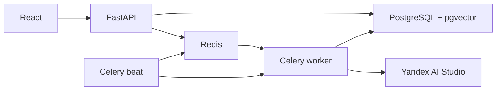

# Архитектура по кейсу № 5

Основание: «Презентация - мероприятие ТПУ.pptx», слайды 5–7 и 21–23.
В «Презентации на 1 октября.pptx» — организационные сведения, без отдельного ТЗ кейса.

API сохраняет файл и задание, публикует UUID в Redis и сразу возвращает 202.
Celery-worker выполняет извлечение, эмбеддинги, SQL-поиск и ранжирование.
PostgreSQL хранит статусы и результаты; UI читает их через прежний REST API.
Beat повторяет публикацию оставшихся queued-заданий после отказа брокера и запускает очистку.
Старого фонового цикла обработки внутри HTTP-процесса больше нет.

Позднее подтверждение сообщений, повторная доставка и per-job advisory lock
защищают от одновременной обработки дубликата. Отмена отслеживается worker через
базу и передаётся в существующий механизм остановки запросов. При аварийном
перезапуске незавершённая спецификация может обрабатываться повторно.

Worker использует два потока одного процесса, поэтому пять LLM-слотов разделяются
между заданиями и не умножаются как при нескольких prefork-процессах.

pgvector действительно выполняет поиск по таблице catalog_vectors, используя точный
inner product нормализованных векторов. HNSW/IVFFlat не создаются. NumPy сохранён
для пересчёта оценок выбранных кандидатов, сравнения характеристик и автономных тестов.
Файл векторов нужен для первоначального импорта; версии каталога разделены хешем.

В контрольных 100 строках первый код совпал в 99 случаях; при равных оценках
есть перестановки альтернатив. Это не доказательство неизменности всех кодов:
итоговая классификация и время отдельно проверяются приёмкой на 1000 позициях.

Проверены отдельно: реальная доставка Redis/Celery, PDF 51 страница (загрузка 0,16 с),
отмена, безопасная повторная доставка завершённого задания, восстановление после
отказа Redis (загрузка при недоступном брокере около 4 с, восстановление около 5 с).
197 тестов прошли, 10 пропущены из-за отсутствующих старых fixtures; проверки
PostgreSQL и pgvector выполнялись на отдельном сервере. Ruff check/format пройдены.
Старые таблицы восстановлены из dump в новый том.

## Живая приёмка 28 октября 2026

| Проверка | Результат |
|---|---|
| XLSX организаторов, 1000 позиций | 192,612 с от загрузки до done; лимит 300 с |
| Полное совпадение кода с эталоном | 990/1000 (99%); требование ≥85% |
| Резервные правила / словесный режим | 0 / 0 |
| PDF 51 страница | HTTP 202 за 0,264 с; done за 10,611 с; 51 строка |
| CSV: название, бренд, модель | 12/12 для каждого поля |
| Ручная правка и CSV/XLSX-экспорт | прошли |
| Пустой Docker-проект | схема 0002, 81 509 векторов, рабочая доставка двух строк через frontend и Celery |
| Исходные данные после перехода | SHA-256 всех исходных 16 заданий и 7225 позиций совпали |

Модели и настройки классификации сохранены: пять YandexGPT 5.1, один слот на
ключ, LLM_BATCH=10. Замер выполнен на этой машине; время внешних API меняется.
Приёмочные задания остаются в списке, временная тестовая учётная запись удаляется.
JSON прогона сохранён в [eval/reports/case5-architecture-2026-10-28.json](../eval/reports/case5-architecture-2026-10-28.json).

Ограничения: 12 подготовленных примеров не доказывают ≥90% атрибутов на любых
документах; PDF текстовый, без OCR. Проверялся новый Docker-проект с пустыми томами
на текущем компьютере, а не другая физическая машина. Проценты уверенности остаются
оценкой алгоритма; отдельная статистическая калибровка здесь не проводилась.
Техническое задание также требует видео до пяти минут — это отдельный материал
сдачи, изменение архитектуры его не создаёт.

Технические основания: [Celery configuration](https://docs.celeryq.dev/en/stable/userguide/configuration.html),
[pgvector Python/SQLAlchemy](https://github.com/pgvector/pgvector-python).

Последующее исправление процентов для кодов второго мнения и более строгая
проверка приёмки описаны в [confidence-completion-2026-10-28.md](confidence-completion-2026-10-28.md).
Исторический JSON архитектурного прогона выше остаётся исходным отчётом того замера.
